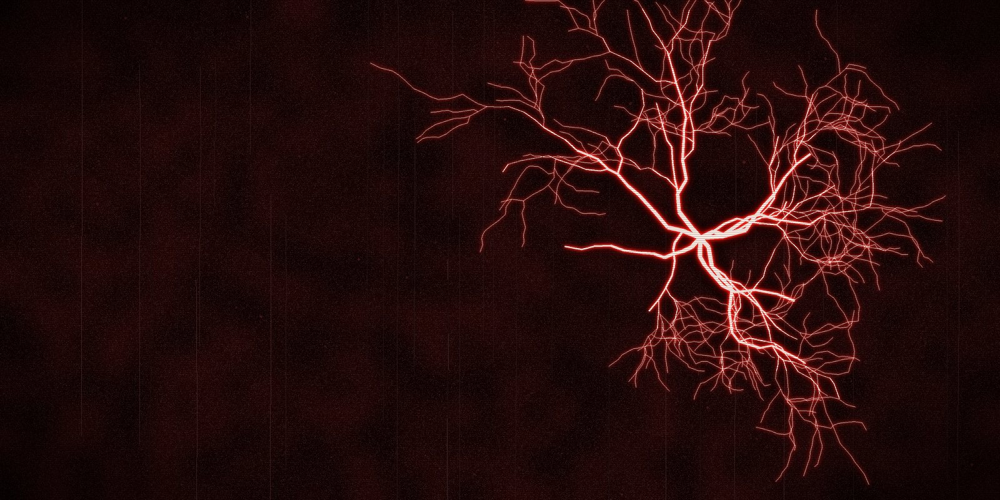

# KRIECHSTROM

by Grigorii Bezborodov

Dark industrial and EBM firmware for the **M-VAVE FM-1**. Built on [Felucca](https://github.com/hugelton/Felucca), with parts
of [Glitchbox](https://github.com/erikdevos/glitchbox): thanks to both for the inspiration and the groundwork.

Kriechstrom is German for creepage current, the leakage across worn insulation that leaves a branching mark like the
one above.

## Why

Glitchbox is built on Felucca 1.5.1 for the older FM-1 flash chip and does not run on the newer units (UC25HQ80,
`0xB36014`). KRIECHSTROM is built on the current Felucca, which supports both, and brings over the parts of Glitchbox it
needed.

## What it adds to Felucca

- **GLCH** engine (from Glitchbox): clipping, wavefolding, a resonant filter, bit crushing and micro-stutter; 48 sounds,
  most with a distortion pedal set
- **171 sounds** in 13 engines, 13 drum kits including DESTROY
- **DICE**: hold SEQ, press F5, the track gets a new part in one of eight moods (MACHINE, GRIND, MARCH 7/8, GLITCH,
  SPIRAL, GHOST, SURGE, HUSH); G5 picks the mood
- **HAPPY ACCIDENT**: hold EDIT, press G5, two or three parameters of the sound change at random; hold SAVE to undo
- **DAMAGE** on the master: tape (darker, wobbling, sagging) to digital (bits, lower rate, hard cuts), its level kept;
  the same as the **DAMG** pedal on one track
- **WALL**: one knob from quiet to a wall (sends, distortion, a squeezed and wider mix, the FILL steps); FX + SELECT
- **HISS**: a tape's noise floor on its own knob
- MUFF, BASS and SMASH pedals, ROLL and GATE live effects (from Glitchbox)
- power-on sounds and patterns that play when PLAY is pressed
- the STROM theme (black and red), large values and hints on screen, effects that toggle with a tap
- its own USB name and identity `FM-1_57810001`; works with the newer FM-1 flash (`0xB36014`)

**Projects and sounds:** KRIECHSTROM reads Felucca's projects, user presets and samples as they are. Projects of
other firmwares are not read; back them up before installing.

Everything Felucca does still works: the 64-step sequencer with locks, conditions, ratchets, automation and songs,
the FX layer, chord keys, the arpeggiator, MIDI in over USB and TRS, MIDI learn, USB audio, the web editor.

## Install

Connect the FM-1 by USB and open the web installer in Chrome or Edge:
https://xforsa.github.io/kriechstrom/webapp/installer/ (or the `.fwsc` from the
[releases](https://github.com/Xforsa/kriechstrom/releases) with `tools/fm1_install.py`). The installer can take you
back to the official V15. Back up your projects first.

## Manual

English: https://xforsa.github.io/kriechstrom/manual/en.html, Russian: https://xforsa.github.io/kriechstrom/manual/ru.html,
with a cheat sheet of the button combinations that are not printed on the panel.

## Build

See [BUILDING.md](BUILDING.md). In short: `./build.sh --release X.Y` (Docker and the JieLi toolchain), then
`sh tests/run_tests.sh` for the host tests.

## Contributing

Bugs to [Issues](https://github.com/Xforsa/kriechstrom/issues), ideas and music to
[Discussions](https://github.com/Xforsa/kriechstrom/discussions). See [CONTRIBUTING.md](CONTRIBUTING.md) and
[CHANGELOG.md](CHANGELOG.md).

## Credits and licence

KRIECHSTROM is a fork of **Felucca** by Leo Kuroshita, Hügelton Instruments (GPL-3.0-only), with the GLCH engine, the
DESTROY kit, the MUFF / BASS / SMASH pedals and ROLL / GATE from **Glitchbox** by erikdevos (GPL-3.0-only) and ideas
from **DIRGE** by sinscum. Everything Felucca credits is in [CREDITS.md](CREDITS.md); the licences in
[LICENSING.md](LICENSING.md) and [LICENSES/](LICENSES/).

Free software under the [GPL-3.0-only](LICENSE): if you share builds, share the source. Not affiliated with M-VAVE or
Hügelton Instruments. M-VAVE and FM-1 are trademarks of their owners.
