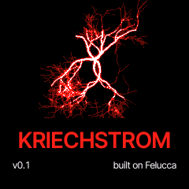

# KRIECHSTROM 0.1

The first release: dark industrial and EBM firmware for the M-VAVE FM-1, built on Felucca 1.8.2 with parts of
Glitchbox.

## Install

1. Back up your projects and presets (the editor's Complete backup).
2. Connect the FM-1 by USB, open the [web installer](https://xforsa.github.io/kriechstrom/webapp/installer/) in Chrome
   or Edge, press Install.
   Or: `python3 tools/fm1_install.py kriechstrom-0.1.fwsc`.
3. The FM-1 restarts with the KRIECHSTROM splash. To hear the power-on patterns: hold HOME, SYSTEM > CLEAR ALL, OCT+,
   OCT+, then PLAY.

The installer can take you back to the official V15 (Return to official V15, with M-VAVE's unmodified `FM-1.fwsc`).

## Highlights

- **GLCH** engine (from Glitchbox): clipping, wavefolding, a resonant filter, bit crushing and micro-stutter; 48 sounds
- **171 sounds** in 13 engines, 13 drum kits
- **DICE** (hold SEQ, F5) writes a new part in one of eight moods (G5)
- **HAPPY ACCIDENT** (hold EDIT, G5): two or three parameters of the sound change at random; hold SAVE to undo
- **DAMAGE**, **WALL** and **HISS** on FX > DAMAGE: tape or digital degradation, more density and width, tape noise;
  the level is kept
- tap-to-toggle live effects, effect pages named for players, a manual and a cheat sheet in English and Russian

Full list: [CHANGELOG.md](https://github.com/Xforsa/kriechstrom/blob/main/CHANGELOG.md).
Manual: [English](https://xforsa.github.io/kriechstrom/manual/en.html),
[Russian](https://xforsa.github.io/kriechstrom/manual/ru.html).

## Notes

- Identity `FM-1_57810001`, USB name KRIECHSTROM. On a Mac the MIDI port may keep an old name until the device is
  removed in Audio MIDI Setup's MIDI Studio and plugged in again.
- Tested on an FM-1 with the newer flash (UC25HQ80, `0xB36014`). The older flash is Felucca's code path, not tested
  with this release.
- Felucca projects and presets load. MENU > RESTORE LAST brings back the music you left; CLEAR ALL starts fresh.

## Files

| File | What |
| --- | --- |
| `kriechstrom-0.1.fwsc` | the package: the app and the update loader |
| `kriechstrom-0.1-src.tar.gz` | the complete source of this build (GPL-3.0) |
| `SHA256SUMS` | checksums |

## Credits

Built on [Felucca](https://github.com/hugelton/Felucca) by Leo Kuroshita, Hügelton Instruments, with parts of
[Glitchbox](https://github.com/erikdevos/glitchbox) by erikdevos and ideas from
[DIRGE](https://github.com/sinscum/DIRGE) by sinscum. Thanks to all three for the inspiration. GPL-3.0-only.
